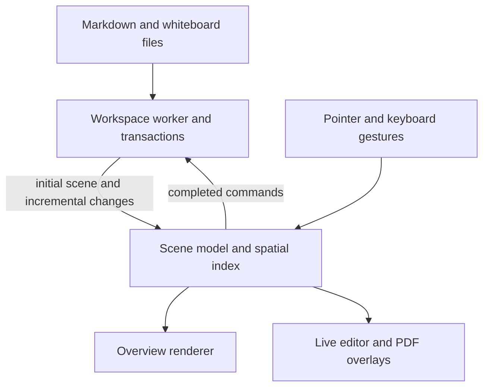

# Whiteboard foundation proposal

Status: proposed for review, October 22, 2026. The user agreed to a target of 10,000 mixed elements. This is not a claim that the current renderer meets that target. No renderer replacement or new rendering dependency has been installed. Native experiments and adoption limits are recorded in the [rendering comparison](rendering-comparison.md).

## Recommendation

Keep Electron, TypeScript, the Markdown/whiteboard formats, the workspace worker and the existing rich editor. Separate the whiteboard's scene, interactions and commands from its drawing backend. Evaluate a retained overview, with the existing DOM editor and PDF reader used for live interaction. Initial Canvas and WebGL experiments both remove most of the warm overview drawing cost, but do not yet pass the full adoption gates. Evaluate PixiJS only if a representative tile/scene implementation shows a reason to add it. Choose the renderer after a representative 10,000-element prototype passes the gates below, before building more board features.

A language rewrite would not directly remove repeated DOM layout, full workspace snapshots, redundant preview generation or oversized PDF rendering. Rust/WASM or a native helper remains an option for an identified CPU-heavy task. That task should sit behind a narrow asynchronous interface, so moving it does not change the document format or interaction model. Native modules add binary/ABI and packaging work; Electron documents those requirements in its [native module guide](https://www.electronjs.org/docs/latest/tutorial/using-native-node-modules). Long computations belong outside the UI thread; see [Electron performance guidance](https://www.electronjs.org/docs/latest/tutorial/performance).

PixiJS is a drawing library rather than a complete board/editor replacement. Its [renderer documentation](https://pixijs.com/8.x/guides/components/renderers) recommends WebGL/WebGL2 for production, while WebGPU remains an evaluation path. Its [repository](https://github.com/pixijs/pixijs) uses the MIT license. It does not supply our Markdown editing, PDF annotations, undo, drag/drop or accessibility semantics; those must pass prototype parity checks.

A full SDK such as tldraw is an alternative if we decide its interaction model is preferable to ours. Its [performance design](https://tldraw.dev/sdk-features/performance) combines spatial indexing, granular updates, geometry caching, stable zoom and level of detail. Its [current production licensing](https://tldraw.dev/community/license) requires a commercial or discretionary hobby license. Adopting it would require explicit licensing and migration decisions. It is not an automatic shortcut for our rich cards and PDF readers.

The [bounded preview follow-up](bounded-previews.md) provides additional evidence for retained tiles and a live editor handoff. It does not change the adoption requirements below.

## Boundaries to settle now

The drawing backend must not own authoritative card content, file ownership or undo. Stable IDs, references, current board semantics and revision-checked transactions remain the contract. Camera coordinates, selection, bounds, hit regions and transient drag transforms belong to the scene/interaction layer. Rendering can change without migrating users' files.

Use one geometry cache for drawing, edges, connectors, selection and hit testing. Query a spatial index for the current view and pointer neighborhood; update only objects whose geometry changed. Cache measured card dimensions by content revision, width and font/theme identity, rather than measuring every offscreen card on each board open. Use camera-relative coordinates before GPU projection to avoid precision jitter far from the origin.

Camera frames should update a transform, visible-set changes and small overlay state. They should not save files, read note bodies, clone the whole workspace, rebuild all edges or rerender the complete React tree. A multi-selection drag uses transient transforms and commits one grouped command. Only incident edges need updates during that drag. Worker results should describe changed records with revision/order information; an initial full snapshot is still useful at workspace open and recovery.

## Detail and resource policy

Viewport culling alone is insufficient: when zoomed far out, all 10,000 elements can fit onscreen. Detail must depend on projected size, not merely whether something is visible.

| Projected appearance | Proposed representation |
| --- | --- |
| Too small to read | Shape, color and connection topology; no live Markdown editor or PDF text layer |
| Small but useful | Cached card/PDF/image preview at an appropriate resolution |
| Readable and interactive | Existing rich DOM content where useful, with a bounded number of live regions |
| Being edited or annotated | Existing editor/reader overlay with normal caret, IME, selection, search and annotation behavior |

These are proposed representation rules, not a new visual theme. Choose exact thresholds from real content and use hysteresis so detail does not oscillate near a boundary. Preserve the last completed preview until its replacement is ready. The PDF fix in this pass implements that last rule for its visible page canvas.

Keep separate byte budgets for decoded images, PDF documents/pages, preview bitmaps and GPU textures. Size previews to screen demand and evict inactive entries with an LRU policy; invalidate them by source revision/checksum. The cache is rebuildable application data, not extra files in the user's board folders. Reading position and annotations remain independent of cached pixels. At overview scale, an expanded PDF reserves its layout but does not need a live reader for every page. Background work prioritizes visible and active content and is cancellable when that demand changes. Idle boards must not run a continuous repaint loop.

Native interaction must remain direct. Links, checkboxes, image tools, Text shortcuts and PDF selection must work on the first intended interaction. A cached preview cannot simply become an inert picture requiring extra clicks. The prototype must validate semantic hit regions and promotion to live content without geometry shifts, camera jumps, lost pointer events or lost caret/selection. Keyboard access, accessibility, CJK/IME, math/code, external drops and our existing style controls are migration requirements.

## What the current measurements establish

On this Mac, the existing synthetic 10,000-card workspace benchmark reported a 2.8-second warm index open, a 60.78 ms metadata snapshot and about 2,449 KB of serialized snapshot data. This work is worker-owned, but repeated snapshots still add command latency, copying and renderer invalidation. It is a reason to introduce granular updates, not evidence that the whole app is already fast enough.

A renderer geometry microbenchmark with 10,000 placements and 40,000 connector points built its cache in 5.55 ms. Cached radius-plus-nearest queries measured 0.259 ms at the 95th percentile and 0.621 ms maximum across 1,000 measured queries after warmup. It deliberately excludes DOM, GPU, text/PDF painting, IPC, index work and frame scheduling. It supports keeping these calculations in TypeScript initially; it does not establish 10,000-element UI frame rates.

The Review snapshot used for the PDF continuity fix contains seven PDFs and 88 pages. The old renderer failed the same continuous-visibility check that the new renderer passes. That is a regression check for flashing, not a substitute for the full scale prototype. In the October 22 snapshot, overview pan/zoom frame intervals measured 41.5/32.2 ms at the 95th percentile, and reading-zoom pan measured 17.4 ms. The overview is still outside the proposed budget; this work does not declare board performance settled.

## Prototype and acceptance gates

1. Save a representative mixed scene and native interaction replay. Include long Markdown, code/math, CJK, differently sized images, scanned and vector PDFs, comments, nested boards, references and dense edges. Include an all-elements overview and a heavily overlapping case; do not benchmark only empty rectangles or thousands of copies of one texture.
2. Compare the current renderer and the proposed overview backend against that scene, with the same editor, commands and files. Measure steady-state gestures separately from cold indexing/preview loading. Keep experimental rendering out of the normal user's workspace until parity checks pass.
3. Extract the scene/interaction boundary and incremental updates, then migrate rendering behind it. Keep a rollback path while validating the real Review workspace and the large fixture.
4. Make correctness/resource tests part of normal checks. Run native timing suites on named macOS and Windows reference machines; shared CI timing noise should not be mistaken for a stable hardware performance guarantee.

Proposed initial budgets, to validate on the agreed reference hardware:

| Operation | Gate |
| --- | --- |
| Steady pan/zoom/drag, normal view and full overview | Target 60 fps on a 60 Hz display; p95 frame interval <= 20 ms, p99 <= 33 ms; report long frames rather than averaging them away |
| Cached pointer hit/snap query | p95 <= 2 ms |
| Switching to a warm board | Interactive shell and camera <= 100 ms; previews can refine progressively |
| Camera movement | No note reads, disk mutations or full-workspace snapshots caused by each frame |
| Visible preview refinement | No blanking of an already displayed image; obsolete work never commits over a newer result |
| Memory | Hard byte budgets for each cache; repeated board/tab/zoom cycles reach a plateau rather than growing indefinitely |
| Editing and multi-select | First-click semantics preserved; no lost content, caret or selections; one gesture remains one undo group |
| GPU failure | Recover without losing data; provide a tested reduced renderer or existing-renderer recovery path |

Cache limits should be tuned from measured peak memory on an integrated-GPU machine, not picked from texture count alone. A 10,000-element limit is a workload target, not permission to keep 10,000 full editors, high-resolution images or PDF pages live.

We can lock the storage/command/scene boundaries now. The final renderer choice becomes settled when the mixed prototype passes these gates; neither a language switch nor a library choice can honestly guarantee that no future profiling is needed.
